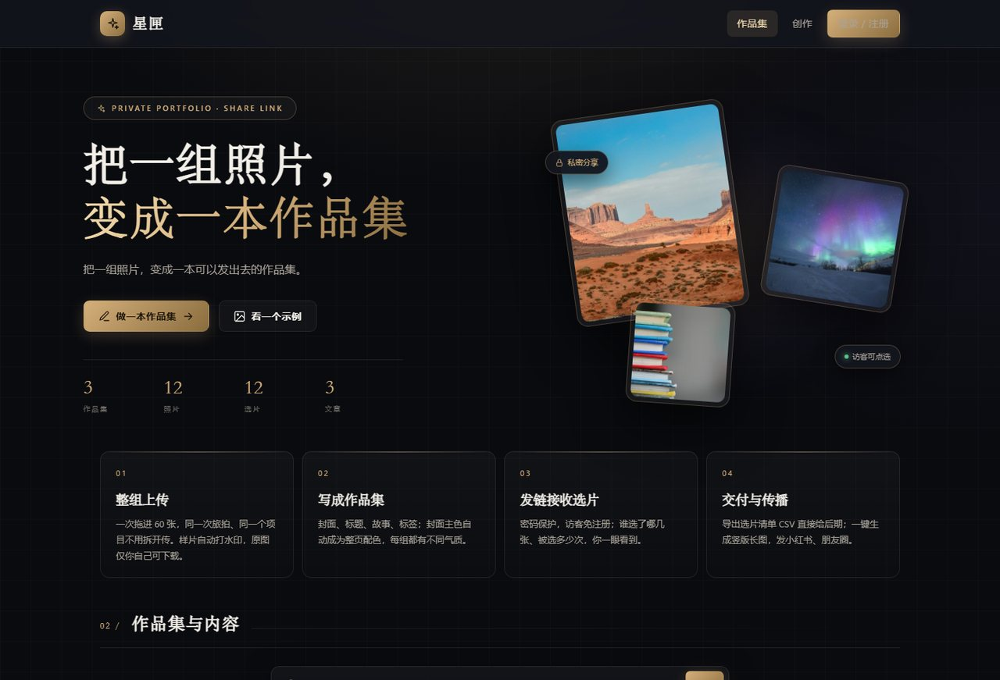
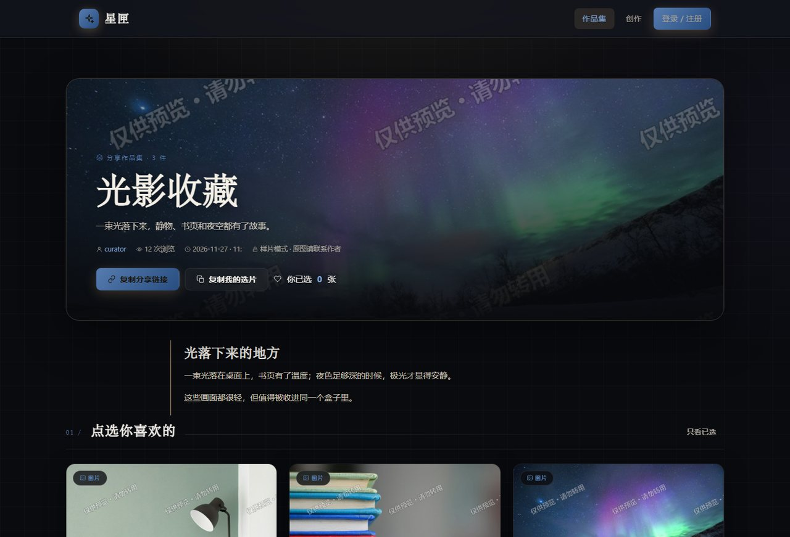
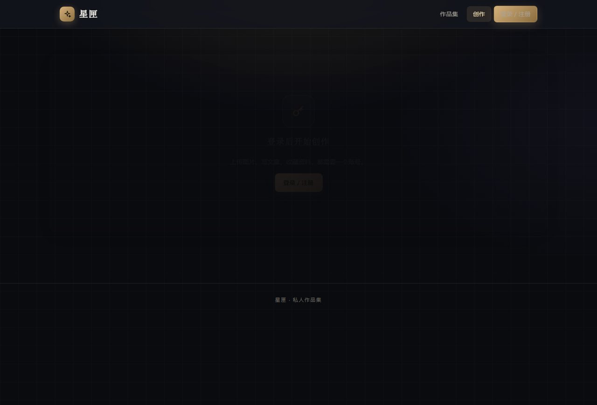

# 星匣 · 私人作品集

[English](README_EN.md) | 中文

> 把一组照片，变成一本可以发出去的作品集。


---





## 为什么是星匣

- **不是网盘**：把链接发给朋友或客户，对方不用注册、不用装 App，打开就能看。
- **不是普通相册**：封面、标题、故事、标签、密码，一组照片是一本完整的作品。
- **不是公开社交**：公开、私密、密码、可重置分享链接，只给该看的人看。
- **能交付**：样片自动加水印，原图只在作者手里；客户点选后导出选片清单，再一键生成竖版长图。

核心流程：**批量上传 → 写成作品集 → 发链接收选片 → 导出交付**。

## 功能

- **批量上传**：一次最多 60 张，自动归入同一作品集，单文件最大 50MB
- **水印样片**：上传时可开关，水印文字可自定义；访客看到的是水印预览图与样片，原图仅作者与管理员可下载
- **封面主色**：从封面自动提取强调色，整页配色随作品集变化
- **作品集**：封面、描述、Markdown 故事、标签、可见性、访问密码
- **分享链接**：`/s/<token>` 短链接，可一键复制、可重置；密码作品集需输入密码
- **访客选片**：访客免注册点选，作者可查看每张被选次数，访客可复制自己的选片清单
- **选片清单导出**：作者一键导出 CSV（含被选次数），直接交给后期
- **竖版长图**：一键生成 1080 宽作品集长图，可直接发小红书 / 朋友圈 / 微博
- **拍摄参数**：自动读取 EXIF，展示相机、镜头、焦段、光圈、快门、ISO
- **三档可见性**：公开 / 私密（仅自己和管理员）/ 密码保护
- **文件柜**：PDF、文档、压缩包、音视频等，登录后下载
- **博客文章**：Markdown 编辑，支持标题、列表、代码、引用、图片
- **标签与搜索**：按类型、标签筛选，标题/正文/标签全文搜索
- **用户系统**：注册登录、首位用户自动管理员、改密码、注销账户、公开主页
- **管理后台**：内容与可见性、用户、站点名称/公告/简介/水印文字设置
- **安全**：PBKDF2 密码哈希、HttpOnly 会话、媒体鉴权、上传白名单、密码尝试限流；作品集详情不会泄露组内私密内容

## 技术栈

Python 3.8+ 标准库 `http.server` + SQLite，前端原生 HTML/CSS/JS，无需构建，无第三方 Web 框架。

图像能力（水印、缩略图、主色、EXIF、长图）依赖 **Pillow**；未安装时自动降级为原图直出，站点仍可正常使用。

```bash
pip install Pillow
```

## 启动

```bash
git clone https://github.com/jacksun-king/starbox-portfolio.git
cd starbox-portfolio
python server.py
```

打开 `http://127.0.0.1:8766/`。改端口：`PORT=9000 python server.py`。

**首个注册的账号自动成为管理员。**

## 演示数据

全新克隆是空站。想直接看到完整效果，跑一次演示数据：

```bash
python seed_demo.py
```

会生成 3 个作品集、12 张照片（含私密与密码示例）、3 篇文章和 18 条示例选片，演示账号 **`curator / demo123`**。
原图在 `demo/photos/`，水印样片与缩略图由 Pillow 现场生成；重复执行不会覆盖，重建用 `python seed_demo.py --force`。



## 页面

| 页面 | 地址 | 说明 |
| --- | --- | --- |
| 首页 | `/index.html` | 作品集优先展示、搜索筛选、四步说明 |
| 作品集 | `/collection.html?id=<id>` | 封面、故事、整组浏览、选片、分享、下载长图 |
| 分享页 | `/s/<token>` | 发给朋友/客户的短链接，免注册查看 |
| 详情 | `/item.html?id=<id>` | 查看内容、拍摄参数、解锁、复制图床链接、归入作品集 |
| 创作 | `/studio.html` | 批量上传、水印设置、新建作品集、写文章、我的内容 |
| 登录注册 | `/auth.html` | 首位注册者为管理员 |
| 用户主页 | `/profile.html?user=<用户名>` | 他人公开信息与内容 |
| 设置 | `/settings.html` | 资料、改密码、注销 |
| 管理 | `/admin.html` | 仅管理员 |

## 目录结构

```text
starbox-portfolio/
├─ server.py            # 单文件后端：路由、鉴权、上传、作品集、分享、导出
├─ imaging.py           # Pillow 图像处理：水印、缩略图、主色、EXIF、长图
├─ seed_demo.py         # 演示数据生成器
├─ demo/photos/         # 12 张演示原图
├─ index.html           # 首页
├─ collection.html      # 作品集 / 分享页
├─ item.html            # 内容详情
├─ studio.html          # 创作台
├─ auth.html profile.html settings.html admin.html
├─ css/style.css        # 暗色金色视觉系统
├─ js/common.js         # 图标、卡片、请求封装
├─ data/                # 运行时生成：SQLite、密钥、长图缓存（不入库）
└─ uploads/             # 运行时生成：原图、水印版、缩略图（不入库）
```

## 数据

- `data/site.db` — SQLite 数据库（用户、内容、作品集、选片、文件、设置）
- `data/secret.key` — 密码解锁签名密钥（**删除后所有解锁 Cookie 失效**）
- `data/cache/` — 生成的作品集长图缓存
- `uploads/` — 原图、`*_wm.jpg` 水印样片、`*_s.jpg` 列表缩略图
- 数据库含密码哈希，已在 `.gitignore` 中排除，不要提交公开仓库

## API

公开：`GET /api/config`、`/api/items`、`/api/collections`、`/api/tags`、`/api/users/<name>`、`/api/share/<token>`、`/api/media?id=&size=s`；`POST /api/register`、`/api/login`、`/api/logout`、`/api/unlock`、`/api/collections/<id>/pick`

需登录：`GET /api/items?scope=mine`、`/api/collections?scope=mine`、`/api/me`、`/api/download?id=`、`/api/media?id=&raw=1`（作者取原图）、`/api/collections/<id>/poster`（长图）、`/api/collections/<id>/picks.csv`（选片清单）；`POST /api/upload`（多 `file` 字段 + `collection_id`/`new_collection`/`watermark`/`watermark_text`）、`/api/collections`、`/api/post`、`/api/me/password`、`/api/me/profile`；`PATCH /api/items/<id>`（含 `collection_id`）、`/api/collections/<id>`（含 `story`/`allow_pick`/`regenerate_share`）；`DELETE /api/items/<id>`、`/api/collections/<id>`、`/api/me`

管理员：`GET /api/items?scope=all`、`/api/users`；`POST /api/settings`（含 `watermark_text`）；`PATCH /api/users/<id>`；`DELETE /api/users/<id>`

## 公网部署

用 Cloudflare Tunnel 把本机服务暴露成 HTTPS 域名，不需要公网 IP：

```bash
cloudflared tunnel --url http://127.0.0.1:8766
```

公网开放后**第一时间注册管理员账号**。长期使用建议用 Named Tunnel 绑定固定域名。

## License

MIT
